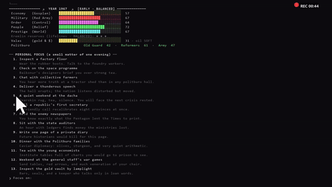
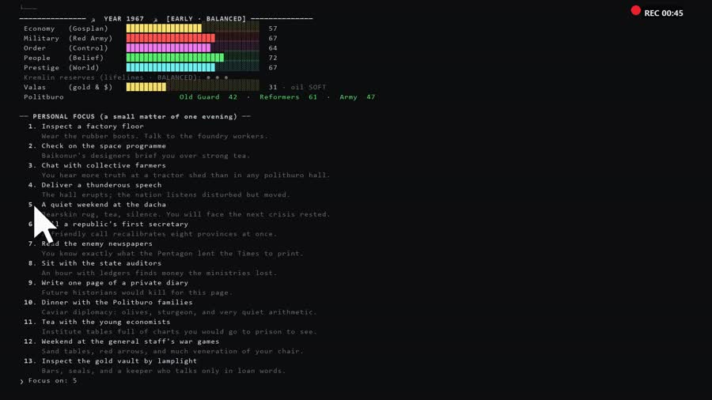
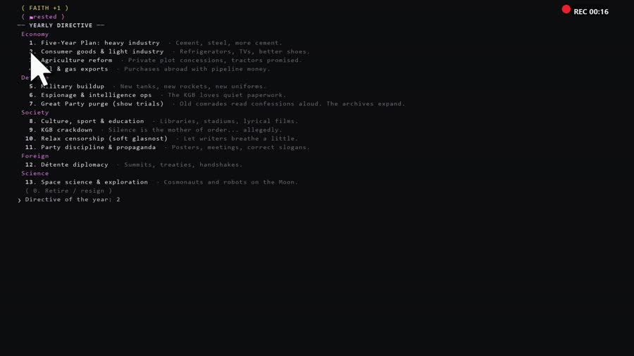
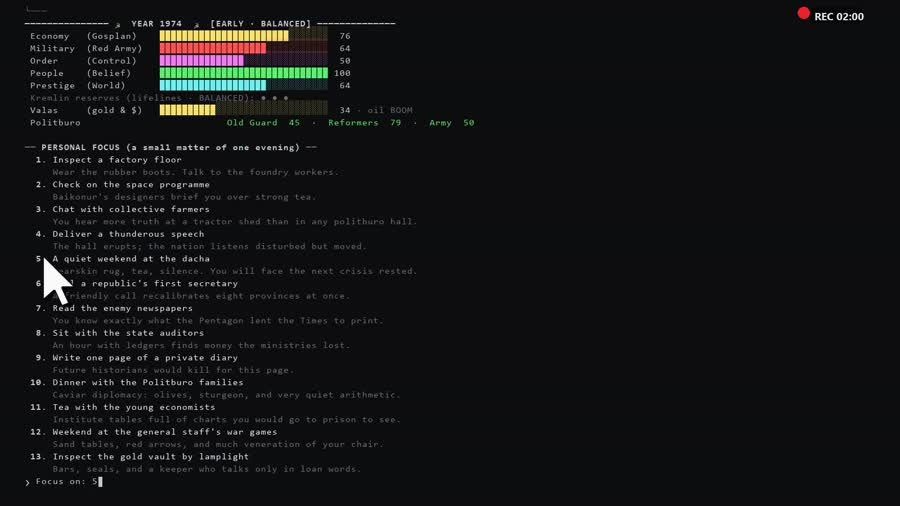
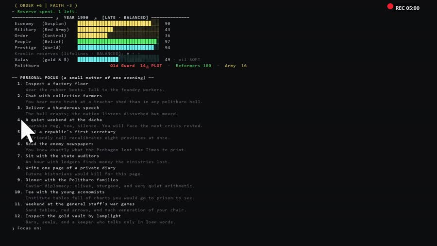

<div align="center">

# ☭ КРЕМЛЬ 1991 — General Secretary

### A text-based Soviet alternate-history game you play in your terminal

**You are the General Secretary of the CPSU. It is October 1964. You have 27 years,
five collapsing gauges, three suspicious factions and a hard-currency vault that
the oil market keeps emptying.**

Keep the Union breathing to **1991**. End strong enough and the Politburo offers you
ten more years — the **Red Millennium, 1992–2001**. Or lose it all to a velvet coup
and a plenum that erases you from the portraits.

**Pure Python. No installs, no dependencies, no graphics card — just `python main.py`.**

[](https://github.com/mahakammoonlightstudio-beep/kreml-1991/releases)
[](https://www.python.org/)
[](#quick-start)
[](LICENSE)
[](#quick-start)
[](https://mahakammoonlightstudio-beep.github.io/kreml-1991/)

[**▶ Play / landing page**](https://mahakammoonlightstudio-beep.github.io/kreml-1991/) ·
[**⬇ Download BETA v5**](https://github.com/mahakammoonlightstudio-beep/kreml-1991/releases) ·
[**🐛 Report a bug**](https://github.com/mahakammoonlightstudio-beep/kreml-1991/issues)



<sub>A Mahakam Moonlight Studio ☭ production — by **mahakammoonlightstudio-beep** & **Mr. Fozan**</sub>

</div>

---

## What is КРЕМЛЬ 1991?

**КРЕМЛЬ 1991 (Kremlin 1991)** is an **alternate-history strategy game** about running
the Soviet Union — played entirely as text in your terminal, in the spirit of the
classic Cold War political simulators.

You are not a tank commander and there is no map. You are a man with a desk, a
telephone and a **yearly directive**. Every year you choose one public policy, one
private habit, and an answer to whatever crisis the decade throws at you — the Prague
Spring, the oil boom of 1974, Afghanistan, Chernobyl, the coal miners, the Wall.
Then the plan grinds you down again, and the numbers decide whether the Union is
still a country on 31 December.

It is a **text-based strategy game** with the depth of a board game and the tone of a
Politburo briefing: **110 events**, five difficulty presets, four starting timelines,
three divergence forks, five multi-stage chain reactions, and a closing divergence
report that tells you exactly where your century left ours — all in a codebase where
**the content is data and the logic is one generic engine**.

> *"Soviet difficulty is fair, comrade — it is merely not explained."*

---

## Contents

| | |
|---|---|
| [Quick start](#quick-start) | Three commands and you are in the chair |
| [Screenshots](#screenshots) | What the terminal actually looks like |
| [The systems](#the-systems) | Gauges, valas, the court, forks, chains |
| [Difficulty & timelines](#five-difficulties-four-timelines) | Five modes, four openings |
| [A year in the Kremlin](#a-year-in-the-kremlin) | The loop, step by step |
| [Endings & scoring](#endings-and-scoring) | How you win, how you are erased |
| [Survival notes](#survival-notes) | The arithmetic, declassified |
| [CLI reference](#cli-reference) | Every flag |
| [Architecture](#architecture) | Why it isn't spaghetti |
| [FAQ](#faq) | Python version, OS, save files, accuracy |
| [Credits](#credits) | Studio, writers, licence |

---

## Quick start

**Requirements: Python 3.8 or newer. That is the entire list.**

Nothing to `pip install`. No build step. No internet after the clone. The game is
written against the Python standard library only, so it runs the same on
**Windows, Linux and macOS**.

```bash
git clone https://github.com/mahakammoonlightstudio-beep/kreml-1991.git
cd kreml-1991
python main.py
```

Prefer a zip? Grab the **[BETA v5 release](https://github.com/mahakammoonlightstudio-beep/kreml-1991/releases)**,
unzip it, and run `python main.py` from the folder.

On Windows, if `python` opens the Microsoft Store, use `py main.py` instead.

```text
python main.py                          # title screen: pick difficulty + timeline
python main.py --mode medium            # easy | medium | hard | extreme | historical
python main.py --timeline flashpoint    # rails | reform | flashpoint | millennium
python main.py --seed 42                # reproducible run (share the seed, compare scores)
python main.py --no-anim                # plain text: no bars, no sparklines, no animation
python main.py --drama                  # slow typewriter printing
```

**Controls.** `Enter` proceed · `s` save · `l` load · `d` dossier · `q` resign.
Menus take numbers. That is the whole interface, and it has survived since 1964.

---

## Screenshots

| | |
|---|---|
|  |  |
| **The yardstick.** Five gauges with 10-year sparklines, the valas vault, three faction meters — `⚠PLOT` when one of them is done with you. | **The directive.** The yearly public lever: economy, defence, society, foreign policy, science. |
|  |  |
| **«Oil: BOOM».** The valas pays for dinner; the pipeline pays for the navy. | **The late era.** 1990. The plot flickers in the court line. Do the arithmetic early. |

---

## The systems

| System | What it does |
|---|---|
| **⚖ Five gauges** | **Economy · Military · Order · People's Faith · World Prestige.** All five erode every year. Any one that touches zero ends the game with its own themed collapse. |
| **💵 Valas & the oil market** | A yearly oil price index — the 1973 boom, the 1980 peak, the 1986 glut, the late-90s trough — drives a hard-currency reserve. Imports, grain bills and debt service drain it; a dry vault poisons Economy and Faith. |
| **♛ The court & the velvet coup** | **Old Guard · Reformers · Army** keep private moods. Push one to despair and they book your conference room: face them, buy them, or appeal over their heads. Lose and you are **removed by the plenum** — no gauge ever hit zero. |
| **🕰 Divergence forks** | Three doors in the century — **1968** (what Prague means), **1985** (the new Secretary's first hundred days), **1989** (what the Wall means). Each plants a *path* that shifts yearly drift, opens and locks later content, and rewrites your epilogue. Paths can be realigned at the next fork. |
| **⛓ Chain reactions** | Five stories that remember: **Kabul** (stalemate → the decision → the veterans), **Chernobyl** (the cover-up → the dosimeters → the reckoning), **Kosygin's pilot**, **the gold vault**, **the Union Treaty**. Every choice queues a different follow-up. |
| **🗂 The Dossier** | Press `d`: your full decision ledger, every conditional road (*done ▸ open ✖ locked, with the reason*), the forks still in play, delayed consequences in the pipeline, a **TREND** page of 30-year charts, and history's own timetable beside yours. |
| **🌍 Real life & the Western press** | Each year prints a **REAL LIFE** box — the world, and the Soviet street — plus a foreign headline that reacts to what you actually did. |
| **⌛ Plan fatigue** | Repeating the same directive or private habit shrinks its gains (100% → 85% → 70% → … → 35%) while the cost stays whole. Spam one lever and it goes stale. |
| **💾 Save & resume** | `s` writes the whole state — gauges, flags, queues, court, path, fatigue counters, RNG — to `kreml_save.json`. The title screen offers to resume it. Saves from older versions are refused politely instead of crashing. |

### Terminal visuals (v5)

The panel is drawn, not typed: gauges fill in **eighth-of-a-cell steps** (`█▉▊▋▌▍▎▏░`),
every gauge and the oil index keeps a **10-year sparkline** (`▁▂▃▄▅▆▇█`) with a `▲/▼`
delta, the three factions get mini-meters, and each year opens with a short
`░ ▒ ▓ → ☭ 1967 ☭` plate.

It is plain UTF-8, no dependency, and it **switches itself off whenever stdout is not
a terminal** — so tests, pipes and the video recorder stay byte-for-byte deterministic.
`--no-anim` forces it off, `--anim` forces it on.

---

## Five difficulties, four timelines

**Difficulty** changes the yearly drift, your crisis reserves, and whether alternate
history is even allowed.

| Mode | Name | The deal |
|---|---|---|
| `easy` | **SWEEPING REFORMS** | Gentle drift (−1, −2 after 1985), 5 reserves. For architecting the future. |
| `medium` | **BALANCED** | The historical grind: −2 drift, −4 late Economy, 3 reserves. The Union fell once; the margins are thin. |
| `hard` | **OLD GUARD IRON GRASP** | Economy −3, Order −2 a year, 2 reserves. The system fights back. |
| `extreme` | **THE SYSTEM ITSELF** | Drift −8/−10, late Economy −5, a single reserve. The Union is a rumour you must keep alive. |
| `historical` | **HISTORICAL RAILS** | Real decline, alternate-history content **locked**, 2 reserves, and −5 score for every divergence you force (max 40). |

**Timeline** changes who you inherit and when you start. Pick it on the title screen or
with `--timeline`.

| Timeline | Start | What you inherit |
|---|---|---|
| `rails` | 1964 | The standard appointment. The Union exactly as history left it. |
| `reform` | 1964 | **The Reformers' Window** — Kosygin's profit memo already won in 1965. Reformers at 66, the Old Guard counting votes. |
| `flashpoint` | 1980 | **Cold War Flashpoint** — the 40th Army is in the mountains, the Olympics are coming, oil is at its peak. Twelve years left. |
| `millennium` | 1992 | **The Red Millennium** — the treaty held, the flag stayed red. Ten years of the century's last decade, from its first morning. |

Each timeline has its own opening gauges, court, reserve and closing epilogue.

---

## A year in the Kremlin

1. **Command bar** — `[Enter]` proceed · `s` save · `l` load · `d` dossier · `q` resign.
2. **Personal focus** — one small private lever: inspect a factory, give a speech, rest
   at the dacha (softens the next crisis), dine with the Politburo families, walk the
   gold vault by lamplight.
3. **Yearly directive** — one big public policy across five groups
   *(Economy · Defense · Society · Foreign · Science)*, sometimes gated behind an earlier
   decision: you cannot legalise cooperatives without the reform path, and you cannot
   reform prices without cooperatives.
4. **Crisis** — scripted history, era-random events, a great congress (1970 · 1978 ·
   1986 · 1996), a fork year, or a chain paying off a choice you made a decade ago.
   Some years bring two: 1986 runs the congress **and** Chernobyl; 1989 the Wall **and**
   the coal miners' summer.
5. **The numbers** — drift, war attrition, the oil market, court moods, then the new panel.

Then the year rolls over, the plan goes stale, and the Politburo is one year older.

---

## Endings and scoring

- **Survive to 1991** and the flag stays red. Score = gauges + 2 per year governed,
  −25 if you finished on inertia (any gauge under 10), +6 for the Union Treaty, +4 for
  a golden valas cushion. Titles run *Footnote* → *Survivor* (260) → *A steady hand*
  (330) → *Hero of Socialist Labour* (400) → **GENERALISSIMUS OF HISTORY ★** (470).
- **The August Coup is graded**, and the gate is printed on the option:
  `MILITARY + ORDER ≥ 110` holds the Union, `95–109` survives **scarred**
  (Order, Faith, Prestige and every faction take the hit), below `95` the coup wins.
- **Reach the Red Millennium** (gauges ≥ 25, **valas ≥ 30**, and either the Union Treaty
  or Faith ≥ 55 at the 1991 border) and play on to 2001 for **THE RED MILLENNIUM — THE
  UNION NEVER LEFT**, plus the *Author of the Red Millennium* legacy.
- **HISTORICAL RAILS** subtracts 5 score per divergence after the first and tags the run
  `HISTORICAL` or `DIVERGED`.
- Any gauge at **0** → collapse and half score. Lose a palace coup → **deposed**, not
  collapsed. Resign with `q` → retirement, score kept.
- Every run lands in `hall_of_fame.txt` with its score, difficulty **and** timeline.
- The **divergence report** at the end tells you exactly where your timeline left real
  history — and, on the rails, what it cost.

---

## Survival notes

*Declassified by the Ministry, 1964–1991. Reading this makes you a planner; ignoring it
makes you history. Both are legitimate strategies; one of them scores better.*

- **The survival budget.** Drift eats roughly **−175 gauge points** over 27 years
  (EARLY −6/yr, MIDDLE −6/yr, LATE −7/yr) from a starting total of 314. You must earn
  about **+6.5 per year, every year** — and repeating the same comfortable week no
  longer pays full price.
- **1991 is a paywall.** Buy the general staff dinners early: `MILITARY + ORDER` starts
  at 145 and drift claws about 2 a year off that sum. Do the arithmetic by 1980, or plan
  the quiet path and budget Faith for it.
- **The valas is a third economy.** From the 1986 glut the reserve bleeds 10–13 a year
  until 1991. Repeatable answers: *oil & gas exports*, the *second pipeline*, *Western
  loans*, *quiet gold sales*, *Beryozka shops*. Start hoarding by 1985 or don't dream of
  the Millennium.
- **The court keeps scores.** A faction at ≤ 15 books the velvet room for next year; at
  ≤ 28 it grumbles and costs you a point a year. One private dinner per bad year is
  usually enough — and you get at most one blessing a year from a loving court.
- **Lifelines are ammunition, not comfort.** They fire under 35. Saving them for the
  1986–1991 squeeze is how strong runs are built.
- **The Dossier is free.** Read it every few years; the forks page lists gates that are
  about to close forever.

---

## CLI reference

| Flag | Effect |
|---|---|
| `--mode <easy\|medium\|hard\|extreme\|historical>` | Difficulty preset (v4's `normal` still works as an alias of `medium`). |
| `--timeline <rails\|reform\|flashpoint\|millennium>` | Starting scenario and end year. |
| `--seed <int>` | Fixed randomness for reproducible runs. |
| `--no-anim` | Plain text output: no colour bars, sparklines or animation. |
| `--anim` | Force visuals even when stdout is piped. |
| `--drama` | Slow typewriter printing. |

---

## Architecture

**Content is data. Logic is one generic engine.** Adding an event, a directive, a
timeline or a whole new effect means adding data — never rewiring the loop.

```text
main.py                 entry point: args → engine.run
kreml/
  model.py              frozen dataclasses: Event / Option / Directive / Action / Timeline
  state.py              the single mutable state: gauges, flags, queues, ledger, mode,
                        timeline, valas, court moods, path, fatigue counters, history
  ops.py                the effects DSL — every content → state write happens here
  ui.py                 all rendering and input: colours, bars, sparklines, menus, prompts
  engine.py             turn orchestration only (menus → ops → drift → systems → endings)
  persistence.py        save/load: whole state + RNG + timeline + fatigue (schema v5)
  dossier.py            interactive ledger, branch roadmap, pipeline, TREND charts
  content/              PURE DATA, no logic:
    builders.py         tiny constructors shared by every content module
    events.py           events, pools, scripted years, great congresses
    chains.py           the five chain-reaction storylines
    forks.py            divergence forks, paths, path drift, path epilogues
    timelines.py        the four starting scenarios
    directives.py       directives, menu groups, lifelines (alt-history marked)
    actions.py          personal focus actions
    modes.py            five difficulty presets: drift, reserves, rails
    world.py            yearly oil index, court drift, love / coup / grumble lines
    press.py            Western headline reactions
    history.py          yearly flavour lines and the REAL LIFE world notes
    endings.py          endings, scoring, divergence penalty, hall of fame
tests/
  test_mechanics.py     unit checks: queues, gating, coups, drift, valas, court,
                        palace coup, era extension, fatigue, save/load, visuals
  test_io_flow.py       scripted-input flow: save, dossier, load, resume
  run_smoke.py          headless full-game runs across modes and timelines
tools/
  render_gameplay.py    smooth 60 fps "real gameplay" video renderer (Pillow + ffmpeg)
```

Requirements on options and directives — `flags` / `any_flags` / `not_flags` / `stats` /
`min_year` / `max_year` / `hc` / `hc_max` / `court_min` / `court_max` — drive the entire
branching alternate-history layer declaratively.

### Running the checks

```bash
python tests/test_mechanics.py    # 41 mechanic-level self checks
python tests/test_io_flow.py      # save / load / dossier flow via scripted input
python tests/run_smoke.py         # headless full-game smoke runs
```

The video renderer is a developer tool, not a dependency:
`pip install -r requirements-dev.txt` (Pillow + fonttools) and put `ffmpeg` on PATH.

`v1_kreml.py` keeps the original single-file 2021-style build for archaeologists.

---

## FAQ

**Do I need to install anything?**
No. Python 3.8+ and nothing else — no pip packages, no compiler, no assets to download.

**Does it run on Windows?**
Yes, alongside Linux and macOS. If `python` opens the Microsoft Store, run `py main.py`.
For the best picture, use **Windows Terminal** rather than the legacy console — it
handles the block-drawing glyphs and colour properly.

**Is it free?**
Yes. MIT licence, source included, no account, no telemetry, no network calls.

**How long is a run?**
A full 1964–1991 campaign is roughly 60–90 minutes of reading; a Red Millennium run adds
ten more years. Your save lives in `kreml_save.json`, so you can leave mid-decade.

**Is it historically accurate?**
The timetable, the oil shocks, the congresses, the crises and the REAL LIFE notes follow
real history. What you do with them is the alternate part — and on **HISTORICAL RAILS**
the game locks the inventions and charges you score for every detour.

**Can I add my own events?**
Yes — that is the point of the architecture. Add a `Directive`/`Event` to a module in
`kreml/content/`, and the engine will find it. No loop changes required.

**Where are the old versions?**
The v1 build is `v1_kreml.py`. Saves from v3/v4 are refused with a message: the state
gained timeline, path and fatigue fields in v5.

---

## Credits

**A Mahakam Moonlight Studio ☭ production — beep edition.**
Written & directed by **[mahakammoonlightstudio-beep](https://github.com/mahakammoonlightstudio-beep)** and **Mr. Fozan**.

Code licensed **MIT** — see [LICENSE](LICENSE). Historical recordings and the musical
soundtrack used in the rendered videos belong to their respective owners.

<div align="center">

**☭ СТРАНЫ, УХОДЯЩИЕ В ИСТОРИЮ — SALAM DARI KREML, COMRADE. ☭**

If the Union survives, [leave a star](https://github.com/mahakammoonlightstudio-beep/kreml-1991) —
it is the only budget line the Politburo cannot audit.

</div>
