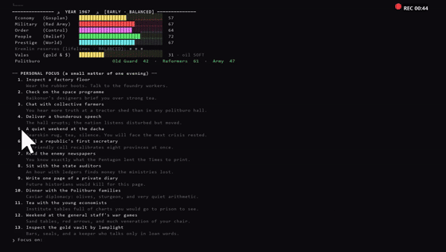

<div align="center">

# ☭ КРЕМЛЬ 1991 — General Secretary

### A text-based Soviet alternate-history game you play in a terminal

**It is October 1964. You are the General Secretary. You have twenty-seven years,
five gauges that only go down, three factions that smile too much, and a hard-currency
vault the oil market keeps borrowing without asking.**

Keep the Union alive until **1991**. Do it well and the Politburo offers you ten more
years: the **Red Millennium, 1992–2001**. Do it badly and a plenum removes you from the
portraits, which is history's way of saying "we'll call you."

**Pure Python. No installs, no dependencies, no graphics card. Just `python main.py`.**

[](https://github.com/mahakammoonlightstudio-beep/kreml-1991/releases/tag/v7-5-beta)
[](https://www.python.org/)
[](#quick-start)
[](LICENSE)
[](#quick-start)
[](https://mahakammoonlightstudio-beep.github.io/kreml-1991/)

[**Play in your browser**](https://mahakammoonlightstudio-beep.github.io/kreml-1991/play/) ·   [**Download BETA v7-5**](https://github.com/mahakammoonlightstudio-beep/kreml-1991/releases/tag/v7-5-beta) ·
[**Landing page**](https://mahakammoonlightstudio-beep.github.io/kreml-1991/) ·
[**Report a bug**](https://github.com/mahakammoonlightstudio-beep/kreml-1991/issues)



<sub>A Mahakam Moonlight Studio ☭ production by **mahakammoonlightstudio-beep** and **Mr. Fozan**</sub>

</div>

---

> "We pretend to work. The plan pretends to pay us."
> — every planning meeting, 1964–1991

## What is this?

**КРЕМЛЬ 1991** is a text-based political survival game about running the Soviet Union.
There is no map. You are not a tank commander. You are a man with a desk, a telephone,
and a yearly directive that has to solve everything at once.

Each year you pick one public policy, one private habit, and an answer to whatever the
decade throws at you: Prague, the 1974 oil boom, Afghanistan, Chernobyl, the coal miners,
the Wall. Then the arithmetic happens, the plan goes stale, and the calendar advances
whether you are ready or not.

There are **123 events**, **37 directives**, **six difficulty presets**, **four starting
timelines**, **three divergence forks**, **five chain reactions** that remember what you
did a decade ago, and now an optional **first-year orientation** for new General
Secretaries. The whole thing is standard-library Python. No pip, no build step,
no telemetry, no network calls after the clone.

**Current release:** [BETA v7-5](https://github.com/mahakammoonlightstudio-beep/kreml-1991/releases/tag/v7-5-beta) · [release notes](RELEASE_NOTES_v7-5.md).

> State joke No. 1: *Under capitalism, man exploits man. Under socialism, it is the other
> way around.*

---

## Contents

| | |
|---|---|
| [Quick start](#quick-start) | Three commands and you are in the chair |
| [How a year works](#how-a-year-works) | The loop, without the ceremonial standing |
| [The gauges](#the-five-gauges) | Five numbers, four ways to lose them |
| [The rest of the machinery](#the-rest-of-the-machinery) | Valas, court, forks, chains, fatigue |
| [Difficulty](#six-difficulties-four-timelines) | Six modes, four openings |
| [Endings](#endings-and-scoring) | How you win, how you get erased |
| [Survival notes](#survival-notes) | The arithmetic, declassified |
| [CLI](#cli-reference) | Every flag, no mystery |
| [Web and itch.io](#the-website-and-the-itch-build) | The game outside your terminal |
| [Architecture](#architecture) | Why it is not spaghetti |
| [Checks and balance](#checks-and-balance) | What we run before believing ourselves |
| [FAQ](#faq) | Python, Windows, saves, accuracy |
| [Credits](#credits) | Studio, writers, licence |

---

## Quick start

Requirements: **Python 3.8 or newer**. That is the entire list. The Ministry of Supply
has approved zero additional dependencies.

```bash
git clone https://github.com/mahakammoonlightstudio-beep/kreml-1991.git
cd kreml-1991
python main.py
```

Prefer a zip? Grab the [BETA v7-5 release](https://github.com/mahakammoonlightstudio-beep/kreml-1991/releases/tag/v7-5-beta),
unzip it, and run `python main.py` from the folder. On Windows, if `python` opens the
Microsoft Store, use `py main.py`. The Store is not a dependency either.

**No terminal?** [Play the browser build](https://mahakammoonlightstudio-beep.github.io/kreml-1991/play/).
It is the same Python compiled to WebAssembly. The first visit pulls about 12 MB of
Pyodide from a CDN; after that it runs offline and keeps your run in the browser.
The play page is mobile-aware: Android Chrome gets a one-column board, 44px touch
targets and a console that does not force the keyboard open after every turn.

```text
python main.py                          # title screen: difficulty + timeline
python main.py --mode medium            # easy | medium | hard | extreme | flash | historical
python main.py --timeline flashpoint    # rails | reform | flashpoint | millennium
python main.py --seed 42                # reproducible run
python main.py --no-anim                # plain text: no bars, sparklines or animation
python main.py --drama                  # slow typewriter printing
python main.py --timed                  # put a real clock on decisions
python main.py --tutorial               # first-year orientation for new players
```

Controls: `Enter` proceed, `s` save, `l` load, `d` dossier, `i` political capital,
`o` standing order, `q` resign. Menus take numbers. The interface has not changed its
mind since 1964.

> State joke No. 2: *The five-year plan took three years to explain and two years to
> forget.*

---

## How a year works

1. **Command bar.** `Enter` proceeds. `s`, `l`, `d`, `i`, `o` and `q` do what the labels
   say. No hidden command mode, no emoji menu.
2. **Personal focus.** A small private lever. Inspect a factory, give a speech, rest at
   the dacha, dine with the Politburo families, or walk the gold vault by lamplight.
3. **Yearly directive.** One big public policy across Economy, Defense, Society, Foreign
   Policy or Science. Some directives are gated by earlier ones. You cannot legalise
   cooperatives without the reform path, and you cannot reform prices without
   cooperatives. This is called "sequencing" when it works and "ideology" when it does not.
4. **Crisis.** Scripted history, an era-random event, a great congress (1970, 1978, 1986,
   1996), a fork year, or a chain paying off an old choice. Some years bring two: 1986
   runs the congress **and** Chernobyl; 1989 brings the Wall **and** the coal miners.
5. **The numbers.** Drift, war attrition, the oil market, court moods, then the new board.
6. **The agenda.** The strongest faction tabled a demand in January. Now it is graded:
   capital paid, or patience lost.

Then the year rolls over, your favourite directive gets stale, and everyone is one year
closer to the ending they have been drafting without you.

---

## The five gauges

| Gauge | What it represents | What zero looks like |
|---|---|---|
| **Economy** | Gosplan's ability to make the plan exist | Empty shelves, then empty rhetoric |
| **Military** | The Red Army's patience and supply | An army that reads the newspapers |
| **Order** | The state's grip on the street | Nobody answers the telephone |
| **People's Faith** | The belief that the future is still coming | Crowds carrying portraits of nobody |
| **Prestige** | How the world sees you | The UN starts scheduling you last |

Every gauge erodes every year. Any one that reaches zero ends the run with its own
collapse screen. There is no "just one more year" unless you planned for it.

> State joke No. 3: *The plan was fulfilled at 105 percent. Of course, only 40 percent of
> it existed.*

---

## The rest of the machinery

| System | What it does |
|---|---|
| **Valas and the oil market** | A yearly oil index drives your hard-currency reserve. The 1973 boom, the 1980 peak, the 1986 glut and the late-1990s trough are all on the calendar. Grain bills, imports and debt service drain the vault. A dry vault poisons Economy and Faith. |
| **The court** | Old Guard, Reformers and Army keep private moods. Push one to despair and it books the velvet room. You can face the plenum, buy the room, or appeal over their heads. Lose and you are **deposed**, not collapsed. Different failure, same obituary. |
| **Divergence forks** | Three doors: 1968 (what Prague means), 1985 (the new Secretary's first hundred days), 1989 (what the Wall means). Each plants a path that shifts yearly drift, opens and locks content, and rewrites the epilogue. Paths can be realigned at the next fork. History is a draft with a filing deadline. |
| **Chain reactions** | Five stories remember your choices: Kabul, Chernobyl, Kosygin's pilot, the gold vault and the Union Treaty. Each stage queues a different follow-up. The bill arrives years later, as bills do. |
| **The Dossier** | Press `d`. You get the decision ledger, every conditional road (done, open, locked, and why), open forks, delayed consequences, TREND charts, and history's timetable next to yours. It is free. Read it. |
| **Plan fatigue** | Repeating the same directive or habit shrinks the gain: 100%, 85%, 70%, eventually 35%. Costs stay whole. Spam one lever and it goes stale. |
| **The first-year orientation (v7-5)** | `--tutorial` or the web button. Five cynical staff memos explain the board, `d` Dossier, `i` capital, `o` standing orders, plan fatigue, the 1991 gate and the valas warning. The first year then gets one-line margin notes; no resources are spent and the difficulty is unchanged. |
| **Republic Unrest (v7-5)** | Four regional fault lines: Baltic, Ukraine, Caucasus, Central Asia. Low Order, open politics and the 1986-1991 shocks raise them; tours, subsidies, a federal compact or the Union Treaty lower them. A hot republic costs Order and Faith, and at 75 it books a crisis. The Millennium gate now includes the regional map. |
| **Event cues (v7-5)** | Short terminal tones on incidents, agenda results and endings; the browser uses Web Audio and has a sound toggle. Pipes, tests and recorders stay silent. |
| **The wall clock (v6)** | `--timed` puts a real countdown on decisions: native in Windows consoles, cbreak on Linux/macOS, visible above the browser input. Freeze and the crisis decides for you; your standing order answers, and the ledger records the hesitation. |
| **Political capital (v6)** | A second currency. Earn influence from the agenda, doctrines and a few choices. Spend it at `i` on dinners, institutes, the vault, a crisis team or an emergency package. One favour a year; repeated favours cost more. You cannot simply buy the court back. |
| **The Politburo agenda (v6)** | Every year the strongest faction tables a demand. Meet it and the Kremlin owes you. Miss it and that faction remembers. A faction with nothing left withdraws instead of plotting. |
| **Standing orders (v6)** | `o` sets the doctrine: party discipline, reform, the mailed fist, patience. It nudges drift, colours the court, and becomes your instinct when the clock runs out. |
| **Saves** | `s` writes the whole state, RNG included, to `kreml_save.json`. The title screen offers to resume. Old saves are refused politely instead of crashing, which is more than the Politburo ever did. |

### The v7-5 board

The interface is drawn, not typed. v7 sets the title in ANSI-Shadow lettering, stencils
the sections, brackets every gauge, and prints the year as a stamped docket line
(`╞═ ☭ 1967 ═══`). Events arrive as wrapped incident sheets instead of a paragraph that
ran into the prompt. v7-5 adds the four-republic unrest strip, short terminal event
cues and a first-year orientation that explains the controls in character.

Everything is plain UTF-8 with no dependency. It switches itself off when stdout is not
a terminal, so tests, pipes and the video recorder stay byte-for-byte deterministic.
`--no-anim` forces it off; `--anim` forces it on.

---

## Six difficulties, four timelines

Difficulty changes the yearly drift, your crisis reserves, and whether alternate history
is allowed at all.

| Mode | Name | The deal |
|---|---|---|
| `easy` | **SWEEPING REFORMS** | Drift −1, then −2 after 1985. Five reserves. For architecting the future. |
| `medium` | **BALANCED** | −2 drift, −4 late Economy, three reserves. The Union fell once; the margins are thin. |
| `hard` | **OLD GUARD IRON GRASP** | Economy −3, Order −2 every year, two reserves. The system fights back. |
| `extreme` | **THE SYSTEM ITSELF** | Drift −8 to −12, late Economy −5, one reserve. The Union is a rumour you must keep alive. |
| `flash` | **FLASH CRISIS** | Nine-second decisions, two reserves, fourteen political capital. Reading is a luxury; instinct is a doctrine. |
| `historical` | **HISTORICAL RAILS** | Real decline, alternate content locked, two reserves, and a score penalty for forcing divergence. |

**Timelines** change who you inherit and when you start.

| Timeline | Start | What you inherit |
|---|---|---|
| `rails` | 1964 | The standard appointment. The Union exactly as history left it. |
| `reform` | 1964 | **The Reformers' Window.** Kosygin's profit memo already won in 1965. Reformers at 66, the Old Guard counting votes. |
| `flashpoint` | 1980 | **Cold War Flashpoint.** The 40th Army is in the mountains, the Olympics are coming, oil is at its peak. Twelve years left. |
| `millennium` | 1992 | **The Red Millennium.** The treaty held, the flag stayed red. Ten years of the last decade, from its first morning. |

Each timeline has its own opening gauges, court, reserve and epilogue.

> State joke No. 4: *A queue is a meeting where nobody has the floor.*

---

## Endings and scoring

- **Survive to 1991.** Score = gauges + 2 per year governed, −25 if you finish on inertia
  (any gauge under 10), +6 for the Union Treaty, +4 for a golden valas cushion. Titles:
  *Footnote*, *Survivor* (260), *A steady hand* (330), *Hero of Socialist Labour* (400),
  **GENERALISSIMUS OF HISTORY ★** (470).
- **The August Coup is graded.** The gate is printed on the option: `MILITARY + ORDER ≥ 110`
  holds the Union; `95–109` survives scarred (Order, Faith, Prestige and every faction
  take the hit); below `95` the coup wins.
- **The Red Millennium** needs gauges ≥ 25, **valas ≥ 30**, no republic above 70 unrest,
  and either the Union Treaty or Faith ≥ 55 at the 1991 border. Then you play to 2001 for
  **THE RED MILLENNIUM: THE UNION NEVER LEFT**, the *Author of the Red Millennium* legacy,
  and a final capstone event that only strong runs can reach.
- **HISTORICAL RAILS** charges nothing for the first detour, then −5 score each, capped at
  40, and tags the run `HISTORICAL` or `DIVERGED`.
- Any gauge at **0** means collapse and half score. A lost palace coup means **deposed**,
  not collapsed. Resign with `q` and you keep the score, which is the retirement plan most
  General Secretaries actually got.
- Every run lands in `hall_of_fame.txt` with score, difficulty and timeline. The divergence
  report at the end tells you where your century left ours, and what the detour cost.

---

## Survival notes

*Declassified by the Ministry, 1964–1991. Reading this makes you a planner. Ignoring it
makes you history. Both are legitimate strategies; one scores better.*

- **The survival budget.** Drift eats roughly −175 gauge points over 27 years (EARLY −6/yr,
  MIDDLE −6/yr, LATE −7/yr) from a starting total of 314. You need about **+6.5 per year,
  every year**. A comfortable week stops paying full price after the first repeat.
- **1991 is a paywall.** `MILITARY + ORDER` starts at 145 and drift claws about 2 a year
  off that sum. Do the arithmetic by 1980, or take the quiet path and budget Faith for it.
- **The valas is a third economy.** From the 1986 glut the reserve bleeds 10–13 a year
  until 1991. Repeatable answers: oil and gas exports, the second pipeline, Western loans,
  quiet gold sales, Beryozka shops. Start hoarding by 1985 or stop dreaming of the
  Millennium.
- **The court keeps scores.** A faction at ≤ 15 books the velvet room; at ≤ 28 it grumbles
  and costs a point a year. One private dinner per bad year is usually enough. You get at
  most one blessing a year from a loving court, so do not plan a wedding.
- **Lifelines are ammunition.** They fire under 35. Saving them for the 1986–1991 squeeze
  is how strong runs are built.
- **The Dossier is free.** Read it every few years. The forks page lists gates that are
  about to close forever, which is the closest the game gets to a warning label.

---

## CLI reference

| Flag | Effect |
|---|---|
| `--mode <easy\|medium\|hard\|extreme\|flash\|historical>` | Difficulty preset. `normal` still works as an alias of `medium`, for veterans of v4. |
| `--timeline <rails\|reform\|flashpoint\|millennium>` | Starting scenario and end year. |
| `--seed <int>` | Fixed randomness for reproducible runs. Share the seed and compare scores. |
| `--no-anim` | Plain text: no colour bars, sparklines or animation. |
| `--anim` | Force visuals even when stdout is piped. |
| `--drama` | Slow typewriter printing. |
| `--timed` | v6 clock: decisions run on a wall clock, in the terminal and the browser. |
| `--no-timed` | Force the clock off. This is the default; the test suite always plays untimed. |
| `--tutorial` | v7-5 first-year orientation: memos, Dossier/capital/orders, fatigue, 1991 and unrest. |
| `--sound` / `--no-sound` | Event cues on/off. They are on for a real terminal, silent for pipes and tests. |
| `--help` | The manual, without the jokes. |

---

## The website and the itch build

The GitHub Pages site is a case file printed on torn paper: bone, soot and oxblood, with
an emblem drawn in SVG and three licensed photographs from the Soviet period. The game
page is the same Python under Pyodide.

- Landing: <https://mahakammoonlightstudio-beep.github.io/kreml-1991/>
- Play: <https://mahakammoonlightstudio-beep.github.io/kreml-1991/play/>
- itch.io: <https://mahakam-moonlight-studio.itch.io/kreml-1991>
- Source of truth: `docs/index.html`, `docs/play/`, `docs/assets/`

The itch.io package is generated, not hand-maintained. The paste-ready page copy,
cover, screenshot captions and upload checklist live in [`itch_page/`](itch_page/README.md):

```bash
python tools/build_itch.py
# itch_upload/kreml-1991-web.zip  (index.html at the ZIP root)
# itch_upload/README.txt         (title, tags, description, upload steps)
```

Upload the zip as an **HTML** project. The package is deliberately small because Pyodide
is fetched from a CDN on first load, like grain from a country with better weather.

The itch page is live at <https://mahakam-moonlight-studio.itch.io/kreml-1991>. The
landing page, play page and footer all point there. The build script does not rewrite
external links.

After changing anything under `kreml/`, rebuild the browser copy:

```bash
python tools/build_web.py          # rewrites docs/play/game_bundle.js
python tools/build_web.py --check  # fails if the bundle is stale
```

The cover, social card and favicon set are rendered from `tools/brand/` with
`python tools/build_brand.py` (headless Chrome). The generated files live in
`docs/assets/`, so a normal build does not need Chrome.

Photo credits live in `docs/media/photo_credits.json` and in the landing page footer.
The game itself ships no photographs, which is the only budget cut the Ministry ever
approved.

---

## Architecture

**Content is data. Logic is one generic engine.** Adding an event, a directive, a timeline
or a new effect means adding data. It does not mean rewiring the loop, unlike adding a
republic.

```text
main.py                 entry point: args -> engine.run
kreml/
  model.py              frozen dataclasses: Event / Option / Directive / Action / Timeline
  state.py              the one mutable state: gauges, flags, queues, ledger, mode,
                        timeline, valas, court, path, fatigue, influence, agenda
  ops.py                the effects DSL; every content -> state write goes through here
  ui.py                 rendering and input: title art, docket plates, gauges, incident
                        sheets, sparklines, menus, the wall clock
  engine.py             turn orchestration: menus -> ops -> drift -> systems -> endings
  persistence.py        save/load: state + RNG + timeline + fatigue + unrest (schema v6)
  dossier.py            ledger, branch roadmap, pipeline, TREND charts
  tutorial.py           v7-5 first-year orientation and in-year margin notes
  content/              PURE DATA, no logic:
    builders.py         constructors shared by every content module
    republics.py        the four regional fault lines and their pressure table
    events.py           the index: pools, scripted years, great congresses
    events_early.py     1964-1975          events_middle.py  1976-1984
    events_late.py      1985-1991          events_new.py     1992-2001
    events_fixed.py     scripted years, congresses, queued responses
    events_v6.py        flash crises and political events (v6)
    agenda.py           the yearly Politburo demand (v6)
    orders.py           standing orders and doctrines (v6)
    capital.py          what political capital buys (v6)
    chains.py           the five chain-reaction stories
    forks.py            divergence forks, paths, path drift, epilogues
    timelines.py        the four openings
    directives.py       directives, menu groups, lifelines
    actions.py          personal focus actions
    modes.py            six difficulty presets: drift, reserves, rails
    world.py            oil index, court drift, coup and grumble lines
    press.py            Western headline reactions
    history.py          yearly flavour and REAL LIFE notes
    endings.py          endings, scoring, divergence penalty, hall of fame
tests/
  test_mechanics.py     56 mechanic-level checks
  test_io_flow.py       scripted save / dossier / load / resume flow
  test_web_build.py     the browser bundle matches the sources
  test_web_driver.py    the browser replay contract (10 checks)
  run_smoke.py          headless full-game runs across modes and timelines
tools/
  build_web.py          packs the game into docs/play/game_bundle.js
  build_itch.py         builds the itch.io folder and zip
  build_brand.py        renders cover, social card and favicon set (Chrome)
  capture_stills.py     renders the itch.io screenshot set from a real run
  balance.py            measured survival rates per mode (autopilot)
  render_gameplay.py    60 fps gameplay renderer (Pillow + ffmpeg, dev only)
docs/
  index.html            the case-file landing page
  assets/emblem.svg     the star, hand-drawn in SVG
  assets/*.css          tokens, base, embedded Martian Mono
  media/photo_*.jpg     licensed photographs and their credits
  play/                 browser build: page, ANSI renderer, Pyodide driver, bundle
itch_page/              paste-ready itch form, description, cover, screenshots
itch_upload/            generated, gitignored; rebuild with tools/build_itch.py
```

Option and directive requirements use `flags`, `any_flags`, `not_flags`, `stats`,
`min_year`, `max_year`, `hc`, `hc_max`, `court_min` and `court_max`. The entire branching
alternate-history layer is declarative. You can add a road without touching the traffic.

---

## Checks and balance

Run these before trusting a change:

```bash
python tests/test_mechanics.py    # 56 mechanic checks
python tests/test_io_flow.py      # save, dossier, load, resume
python tests/test_web_build.py    # bundle is in sync (4 checks)
python tests/test_web_driver.py   # browser replay contract (10 checks)
python tests/run_smoke.py         # headless full games, all modes
python tools/balance.py           # survival rates per mode
```

`tools/balance.py` plays the market-path autopilot headlessly, 5 seeds per mode, clock
off. Two runs bracket the design. v7-5 adds Republic Unrest, so these numbers are not
comparable to the old 12-seed v7 table: hard and extreme now punish a bot that ignores
the regional map.

**Floor** — the bot ignores the political layer (`--no-capital --no-doctrine`):

| mode | survived | avg score |
|---|---|---|
| easy | 5/5 | 371 |
| medium | 5/5 | 347 |
| hard | 3/5 | 202 |
| extreme | 2/5 | 162 |
| flash | 5/5 | 254 |
| historical | 5/5 | 295 |

**Ceiling** — the same bot spends influence and adopts a doctrine:

| mode | survived | avg score |
|---|---|---|
| easy | 5/5 | 373 |
| medium | 5/5 | 348 |
| hard | 3/5 | 209 |
| extreme | 3/5 | 183 |
| flash | 4/5 | 232 |
| historical | 5/5 | 303 |

Read it this way: ignoring the court and the republics is how you die. `hard` and
`extreme` lose runs that the political layer can still save. Mastering it buys survival,
not comfort; the score still falls from 373 on easy to 183 on extreme. Both tables come
from one greedy bot with no foresight, so a player who spends capital badly can do worse
than the floor.

The v7-5 arithmetic adds regional pressure and a crisis at high unrest. The five national
gauges, court, oil market and fatigue rules are otherwise unchanged; the old v7 table's
12/12 hard and extreme results are no longer the correct comparison.

The video renderer is a developer tool, not a dependency:

```bash
pip install -r requirements-dev.txt   # Pillow + fonttools
# ffmpeg must be on PATH
```

`v1_kreml.py` keeps the original single-file build for archaeologists and people who
believe the past was better organised.

---

## FAQ

**Do I need to install anything?**
No. Python 3.8+ and nothing else. No pip packages, no compiler, no assets, no account.
The dependency list is short enough to survive an audit.

**Does it run on Windows?**
Yes, alongside Linux and macOS. If `python` opens the Microsoft Store, run `py main.py`.
Use Windows Terminal rather than the legacy console if you want the block glyphs and
colour to look like the screenshots.

**Is it free?**
Yes. MIT licence, source included, no telemetry, no network calls. The only thing we ask
for is a star, and even that is optional.

**How long is a run?**
A 1964–1991 campaign is roughly 60–90 minutes of reading. The Red Millennium adds ten
years. Saves live in `kreml_save.json`, so you can leave mid-decade without a formal
resignation.

**Is it historically accurate?**
The timetable, oil shocks, congresses, crises and REAL LIFE notes follow real history.
What you do with them is the alternate part. On HISTORICAL RAILS the inventions are
locked and every detour costs score.

**Can I add my own events?**
Yes. Add a `Directive` or `Event` to a module under `kreml/content/`; the engine finds it.
No loop changes required. This is the entire point of the architecture, and also the
reason the content files are bigger than the engine.

**Why is it still called beta?**
Because v6 shipped, v7 shipped, v7-5 is the orientation patch, and the version number is
the one plan we consistently fulfil. There is a save schema that will refuse old saves
rather than corrupt them.

**Where are the old versions?**
`v1_kreml.py` keeps the original single-file build. Saves from v3/v4 are refused with a
message: the state gained timeline, path and fatigue fields in v5.

> State joke No. 5: *The future is certain. It is the past that keeps changing.*

---

## Credits

**A Mahakam Moonlight Studio ☭ production, beep edition.**
Written and directed by [mahakammoonlightstudio-beep](https://github.com/mahakammoonlightstudio-beep)
and **Mr. Fozan**.

Code licensed **MIT**; see [LICENSE](LICENSE). The landing page photographs are licensed
CC BY / CC BY-SA and credited in the page footer and `docs/media/photo_credits.json`.
Historical recordings and the soundtrack used in rendered videos belong to their owners.

The game is free. If you want to fund the next five-year plan:
[PayPal](https://www.paypal.com/paypalme/mrfozan) ·
[Sociabuzz](https://sociabuzz.com/mahakam_moonlight_studio/tribe) ·
[Saweria](https://saweria.co/MahakamMoonStudio). Donations never unlock anything.

<div align="center">

**☭ СТРАНЫ, УХОДЯЩИЕ В ИСТОРИЮ — SALAM DARI KREML, COMRADE. ☭**

If the Union survives, [leave a star](https://github.com/mahakammoonlightstudio-beep/kreml-1991).
It is the only budget line the Politburo cannot audit.

</div>
